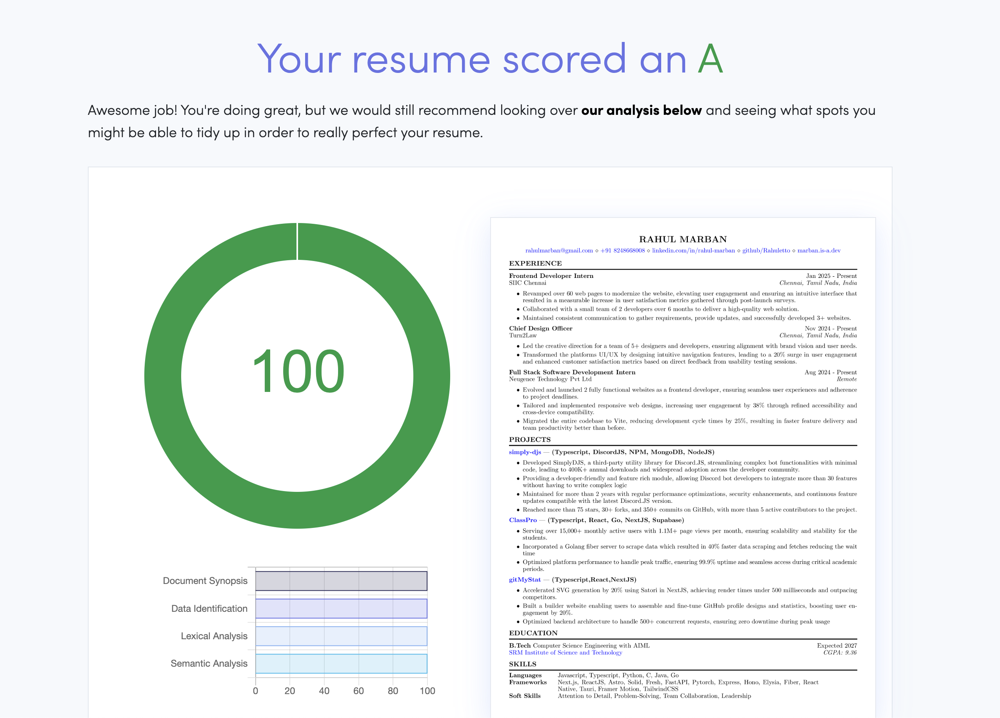

# Automated Resume

This project is designed to automatically update a LaTeX resume template with data fetched from GitHub and LinkedIn. It uses the GitHub GraphQL API and a LinkedIn data scraper API to gather information about repositories, languages, experiences, certifications, and more.



## Features

- Fetches GitHub repository data including name, URL, languages, stargazer count, and description.
- Fetches LinkedIn profile data including positions, certifications, languages, and projects.
- Automatically updates a [LaTeX resume template from Overleaf](https://faangpath.com/template/) with the fetched data.
- Saves API responses to local JSON files to avoid unnecessary API calls during testing.

## Requirements

- Golang 1.24+
- GitHub Personal Access Token
- RapidAPI Key (Linkedin scraping)

## Setup

1. **Clone the repository:**

    ```sh
    git clone https://github.com/rahuletto/auto-resume.git
    cd auto-resume
    ```

3. **Install the required packages:**

    ```sh
    go mod tidy
    ```

4. **Set up environment variables:**

    Create a [.env](https://dotenvx.com/docs/env-file) file in the root directory of the project and add the following environment variables:

    ```env
    TOKEN=your_github_personal_access_token
    LINKEDIN_API_KEY=your_linkedin_scraper_key
    LINKEDIN_PROFILE_URL=your_linkedin_profile_url
    ```

5. **Run the script:**

    ```sh
    go run main.go
    ```

    This will fetch the data from GitHub and LinkedIn, update the LaTeX template, and generate the updated resume.

## LinkedIn fallback

Every run tries the RapidAPI endpoint `professional-network-data.p.rapidapi.com/get-profile-data-by-url` first, using `LINKEDIN_API_KEY`. Valid profiles must contain a first name, last name, username, positions and education. HTTP errors, network errors, malformed JSON and HTTP 200 responses containing empty/error objects all fall back to the tracked `linkedin_data.json` snapshot.

A successful response atomically refreshes the snapshot; CI commits it with the generated resumes so it survives fresh runners. Failed responses never overwrite it. If neither source is valid, generation stops before replacing the resumes. Logs identify the selected source and record HTTP status or validation errors without dumping the profile or API key.

The initial fallback snapshot was recovered from the populated resume outputs in commit `e4c7bca` (November 11, 2026), including the four displayed positions, education, certifications, languages and six displayed projects. It is a recovery snapshot of published resume content, not the original complete API response. Future successful requests replace it with the full modeled response. Edit the JSON to correct stale fallback details.

LinkedIn fetching no longer depends on the `local` flag. The existing GitHub JSON cache behavior is unchanged. Workflow runs are serialized, test the code before generation, and check out the latest `main`.

## Notes

- The GitHub Personal Access Token should have the `repo` scope.
- The RapidAPI Key should be obtained to scrape LinkedIn data.

## License
This project is licensed under the MIT License. See the LICENSE file for details.
